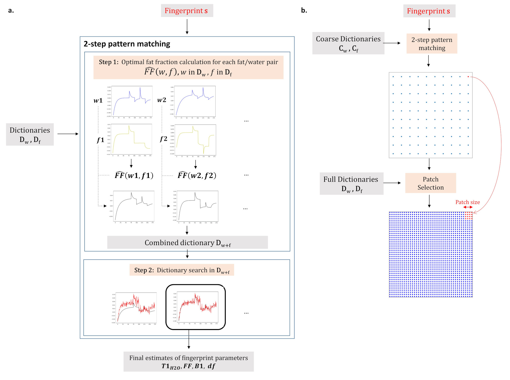

# 2D MR Fingerprinting using bicomponent dictionary matching

Bicomponent dictionary matching for fast reconstruction of quantitative maps from Siemens raw data ([[1]](#1)).

<figure>
  
  <figcaption><i>Figure 1: a. Bicomponent dictionary matching framework - b. Clustering </i></figcaption>
</figure>

## Requirements

After cloning the repository, create an environment and install the package:
```
conda create -n <env> python=3.10
conda activate <env>
pip install -e .
```

Optional extras:
```
pip install -e ".[cupy]"   # GPU dictionary matching
pip install -e ".[test]"   # test suite (pytest)
```

## Data

Example raw data can be pulled using:

```
python scripts/pull_example_data.py
```


## Code

The processing uses several stages, all run through `scripts/cli.py`. Each command writes its outputs **in the folder of its input file** (e.g. `kdata.npy` next to the `.dat` file).

Boolean options (`--siemens`, `--isbuildphi`, `--returncost`, `--useGPU`, `--force`) are enabled by passing `True` and disabled by omitting them: any value given, including `False`, enables them.

### 1. Data extraction

If using the example raw data: 
```
python scripts/cli.py extract_data --filename data/meas_MID00078_FID221413_T1_mapping.dat
```
Outputs `kdata.npy` (k-space data, with radial density adjustment) and `dico_seqParams.pkl` (sequence parameters and image geometry read from the raw data header).


### 2. Coil sensitivities calculation

```
python scripts/cli.py calculate_sensi --filekdata data/kdata.npy
```

### 3. Time serie of undersampled volumes reconstruction

```
python scripts/cli.py build_volumes --filekdata data/kdata.npy --fileb1 data/b1.npy
```

Alternatively, singular volumes can be reconstructed by projecting the time serie on the first `L0` components of a temporal basis derived from the dictionary (see 5. for the dictionary), optionally denoised with `--niter` FISTA iterations and a `wavelet` or `LLR` regularization:
```
python scripts/cli.py build_volumes_singular --filekdata data/kdata.npy --fileb1 data/b1.npy --dictdir mrf_dict --dictfiles dico_TR1.11_reco5.0.pkl --L0 6
```
The temporal basis is computed from the dictionary (water/fat mixtures with fat fraction from 0 to 1) if the dictionary does not already store one.


### 4. Mask reconstruction

```
python scripts/cli.py build_masks --filekdata data/kdata.npy --fileb1 data/b1.npy
```

or, from the singular volumes:
```
python scripts/cli.py build_masks_singular --filevolumes data/volumes_singular.npy --l 0 --threshold 0.025
```

### 5. Parametric Maps reconstruction with pixelwise fitting of the timeserie of volumes on the dictionary

That is where bicomponent dictionary matching is used.

If no dictionary exists for the sequence, it should first be built for the specific dictionary grids, sequence acquisition parameters, echo spacing and recovery time of the acquired data. The echo spacing and inversion time can be read directly from the raw data with `--datafile`:

```
python scripts/cli.py generate_dico --datafile data/meas_MID00078_FID221413_T1_mapping.dat --sequencefile mrftools/dico_config/mrf_sequence_adjusted.json --dictconf mrftools/dico_config/mrf_dictconf_Dico2_Invivo.json --dictconflight mrftools/dico_config/mrf_dictconf_Dico2_Invivo_light_for_matching.json --reco 5.0 --dictdir mrf_dict
```

or given explicitly (in ms):
```
python scripts/cli.py generate_dico --sequencefile mrftools/dico_config/mrf_sequence_adjusted.json --dictconf mrftools/dico_config/mrf_dictconf_Dico2_Invivo.json --dictconflight mrftools/dico_config/mrf_dictconf_Dico2_Invivo_light_for_matching.json --reco 5.0 --echospacing 1.11 --TI 8.32 --dictdir mrf_dict
```

This writes `mrf_dict/dico_TR<echo spacing>_reco<recovery>.pkl` (here `dico_TR1.11_reco5.0.pkl`). Without `--sequencefile`, `--dictconf` or `--dictconflight`, the default configurations of `mrftools/config.py` are used. The command stops if `--dictdir` is not empty, unless `--force True` is given. `--isbuildphi True` also stores the temporal basis and the dictionaries compressed on its first `--pca` components (used by the singular volumes).

Then:
```
python scripts/cli.py build_maps --filevolumes data/volumes.npy --filemasks data/masks.npy --fileseq data/dico_seqParams.pkl --dictdir mrf_dict --dictfiles dico_TR1.11_reco5.0.pkl
```

The echo spacing of the dictionary is checked against the one of the acquisition before matching, and the command stops if they differ. Outputs are written next to `--fileseq`: `maps.pkl` and one `<param>_map.mha` per parameter (`ff`, `wT1`, `attB1`, `df`) with the acquisition geometry.

Options:
- `--pca`: number of temporal PCA components used for matching (default 6)
- `--returncost True`: also returns the matching cost, phase and proton density maps (in `maps.pkl`)
- `--useGPU True`: GPU matching (requires cupy, falls back to CPU otherwise)
- `--volumestype singular`: match singular volumes instead of the time serie (requires a dictionary built with `--isbuildphi True`)

The second matching step searches the full dictionary within windows around the parameters found with the light dictionary (clustering, Figure 1b). The windows (wT1 ±600 ms, fT1 ±100 ms, attB1 ±0.25, df ±0.03 kHz) are set in `scripts/cli.py` and can be passed to `build_maps(..., clustering_windows=...)` in Python. The window bounds are strict: the light dictionary grid spacing should be smaller than twice these windows, otherwise some full dictionary values cannot be reached.

### 6. For C2P users: Siemens IDEA and ICE reconstruction

For streamlining acquisition and reconstruction on the Siemens MRI scanners, one can use an existing .dat file to extract echo spacing and inversion time directly for dictionary generation. Binary dictionaries and varying TE and FA acquisition parameters .txt files can be generated as well for the Siemens IDEA acquistion and ICE reconstruction.

```
python scripts/cli.py generate_dico --datafile path/to/.dat --sequencefile mrftools/dico_config/mrf_sequence_adjusted.json --dictconf mrftools/dico_config/mrf_dictconf_Dico2_Invivo.json --dictconflight mrftools/dico_config/mrf_dictconf_Dico2_Invivo_light_for_matching.json --reco 5.0 --siemens True --suffix <suffix>
```

This additionally writes `dico_TR<echo spacing>_reco<recovery>_<pca>pca.bin` (PCA basis of the full and light dictionaries for ICE) and `ArbitraryFA_<suffix>.txt` / `ArbitraryTE_<suffix>.txt` (flip angle and echo time trains for IDEA) in `--dictdir`.

The ICE binary file can also be generated from an existing dictionary:
```
python scripts/cli.py generate_ice_dico --dicofullfile mrf_dict/dico_TR1.11_reco5.0.pkl --pca 10
```

## Simulation

`mrftools.utils_simu` provides the EPG sequences used to simulate fingerprints:
- `T1MRFSS`: inversion-recovery MRF sequence used for dictionary generation
- `T1MRFSS_NoInv`: same sequence without inversion
- `T1MRFSS_ImperfectInv`: inversion pulse scaled by an inversion efficiency (`att_inv`)
- `T1MRF_generic`: sequence built from a configuration (TE, FA, B1 train, optional TI, readout `FLASH`, `FLASH_ideal`, `FISP`, `pSSFP`, `TrueFISP`...)

Synthetic image series can be generated from parametric maps with `mrftools.image_series.MapFromDict` (see `generate_dixon_volumes_for_segmentation` in `mrftools/main_functions_2D.py` for an example producing in-phase / out-of-phase volumes from MRF maps).

## Tests

```
pip install -e ".[test]"
pytest
```

- `tests/test_clustered_matching.py`: clustered (two-step) dictionary matching on a synthetic dictionary
- `tests/test_main_functions_2D.py`: pipeline functions (sensitivity maps, volumes, masks, dictionary generation, matching, map export) on a simulated phantom and a small EPG dictionary
- `tests/test_cli.py`: every `scripts/cli.py` command run end-to-end on a local raw data file (`data/meas_MID00045_FID06215_MRF2D_bifurc_port_Sl1_2_BW934.dat` by default, another file can be set with `MRFTOOLS_TEST_DATFILE`). Skipped when the file is not available. The commands run in a temporary folder, nothing is written into `data/`.

## Changes

### 1.0.0
- Dictionary generation: echo spacing and inversion time read from the raw data (`generate_dico --datafile`), TI option no longer ignored, ICE binary dictionary and IDEA sequence files (`--siemens`, `generate_ice_dico`)
- Matching: configurable clustering windows and parameter names stored in the dictionary header; fix of the low fat fraction clustered matching (was run with the high fat fraction logic), of the clustering window selection, and of fat fraction groups containing a single voxel
- Temporal basis built from water/fat mixtures including pure water (fat fraction 0 to 1)
- Generic EPG sequences (without inversion, imperfect inversion, configurable readouts), synthetic volume generation, non-local means denoising (`denoise`), DICOM orientation helper
- Test suite

## References
<a id="1">[1]</a> 
Slioussarenko C, Baudin P, Reyngoudt H, Marty B. Bi‐component dictionary matching for MR fingerprinting for efficient quantification of fat fraction and water T1 in skeletal muscle. Magnetic Resonance in Med. March 2024:mrm.29901. doi:10.1002/mrm.29901
